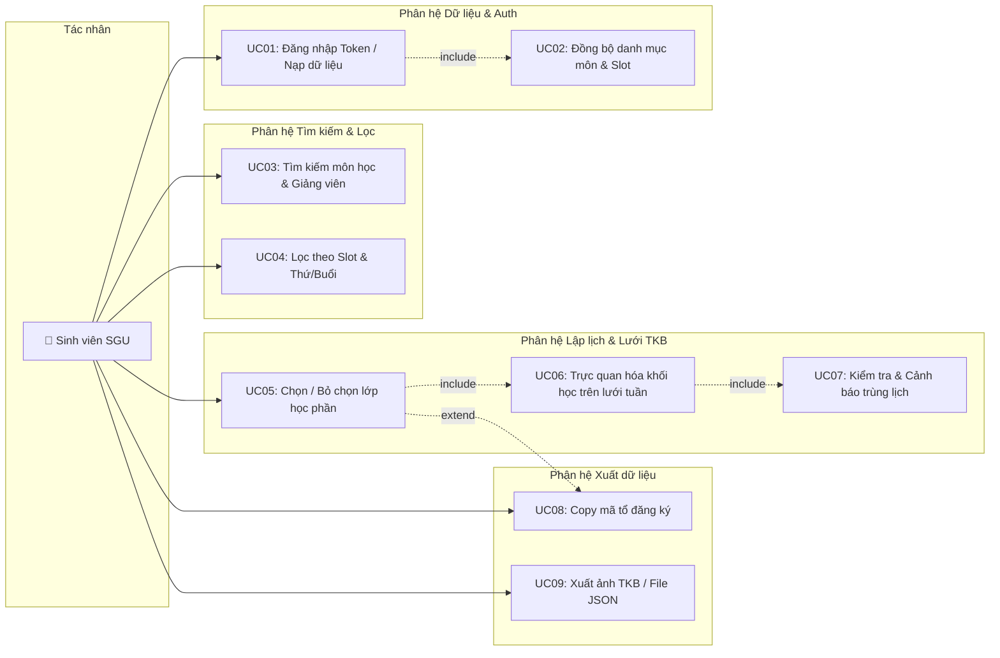
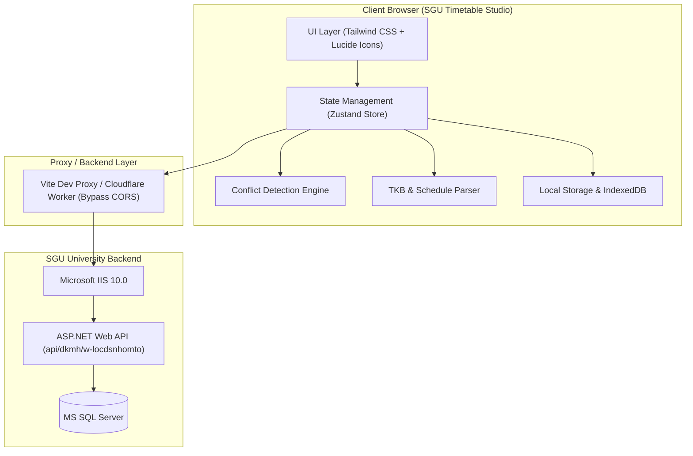
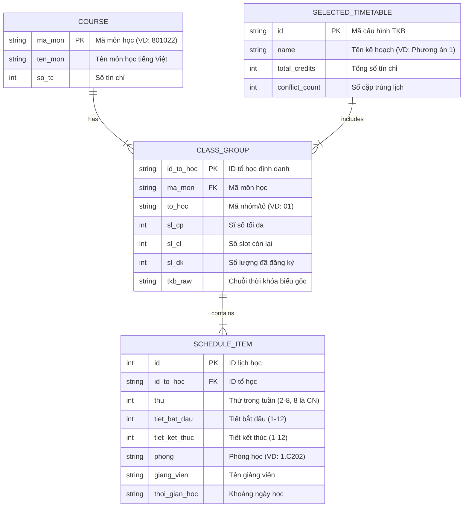

# Tài liệu Đặc tả Yêu cầu Kỹ thuật (Analysis & Specification)
## Dự án: SGU Timetable Studio (Hệ thống Xếp Thời Khóa Biểu & Theo Dõi Slot SGU)
**Phiên bản**: 1.0.0  
**Tác giả**: Omni-IT Architect  
**Trạng thái**: Chờ duyệt (Awaiting Approval)  
**Ngày lập**: 03/11/2026  

---

## 1. Tổng quan Dự án (Project Overview)

### 1.1 Tầm nhìn (Vision)
Xây dựng ứng dụng web hiện đại, chuẩn mực cao, thẩm mỹ 100%, phục vụ sinh viên Trường Đại học Sài Gòn (SGU) trong việc:
1. Tra cứu trực quan danh sách lớp học phần, số slot còn lại thời gian thực từ API `thongtindaotao.sgu.edu.vn`.
2. Trực quan hóa Thời khóa biểu tuần (Thứ 2 – Chủ Nhật, Tiết 1 – 12) với thuật toán tự động phát hiện và cảnh báo trùng lịch.
3. Lên kế hoạch xếp lịch học trước giờ mở cổng, xuất mã đăng ký nhanh (1-click copy) và xuất lịch sang Google Calendar / ảnh PNG.

### 1.2 Đối tượng sử dụng (Target Users)
* **Sinh viên SGU**: Cần công cụ trực quan, mượt mà để xếp TKB, canh slot môn học, chọn giảng viên và phòng học ưng ý trước khi cổng trường mở.

---

## 2. Phân rã Chức năng Nguyên tử (Functional Decomposition)

Hệ thống được chia thành **4 phân hệ** với tổng cộng **28 chức năng nguyên tử (Atomic Leaf Functions)**:

### Phân hệ 1: Dữ liệu & Kết nối SGU API (8 functions)
```
├── 1.1 Quản lý phiên làm việc & Xác thực
│   ├── 1.1.1 Nhập và lưu trữ Bearer Token an toàn (Local Storage / Session)
│   ├── 1.1.2 Kiểm tra trạng thái hoạt động của Token qua API ping/auth
│   ├── 1.1.3 Hỗ trợ đăng xuất và xóa toàn bộ dữ liệu phiên
│   └── 1.1.4 Hỗ trợ chế độ Mock Data / Offline cho người dùng chưa có tài khoản
├── 1.2 Tải và Đồng bộ dữ liệu
│   ├── 1.2.1 Gọi API w-locdsnhomto lấy toàn bộ danh sách lớp học phần
│   ├── 1.2.2 Đồng bộ danh mục tên môn học từ ds_mon_hoc vào mã môn tương ứng
│   ├── 1.2.3 Phân tích (parse) chuỗi TKB thành cấu trúc chuẩn: Thứ, Tiết, Phòng, Giảng viên, Tuần học
│   └── 1.2.4 Lưu cache dữ liệu môn học vào IndexedDB / LocalStorage để tải tức thì
```

### Phân hệ 2: Khám phá & Lọc Môn học (7 functions)
```
├── 2.1 Tìm kiếm & Lọc dữ liệu
│   ├── 2.1.1 Tìm kiếm tức thì theo Tên môn học (hỗ trợ tiếng Việt không dấu)
│   ├── 2.1.2 Tìm kiếm theo Mã môn học
│   ├── 2.1.3 Tìm kiếm theo Tên giảng viên
│   ├── 2.1.4 Lọc theo trạng thái Slot (Tất cả / Còn slot > 0 / Sắp hết <= 5 / Hết slot = 0)
│   ├── 2.1.5 Lọc theo Thứ trong tuần (Thứ 2 đến Chủ Nhật)
│   ├── 2.1.6 Lọc theo Buổi học (Sáng tiết 1-5 / Chiều tiết 6-10 / Tối tiết 11-12)
│   └── 2.1.7 Sắp xếp danh sách (theo Slot tăng dần, Tên môn A-Z, Số tín chỉ)
```

### Phân hệ 3: Lập kế hoạch & Lưới TKB Trực quan (9 functions)
```
├── 3.1 Quản lý Môn chọn
│   ├── 3.1.1 Thêm lớp học phần vào Thời khóa biểu dự kiến
│   ├── 3.1.2 Xóa lớp học phần khỏi Thời khóa biểu dự kiến
│   ├── 3.1.3 Chuyển đổi nhanh nhóm/tổ của cùng một môn học
│   └── 3.1.4 Đặt lại (reset) toàn bộ thời khóa biểu đã chọn
├── 3.2 Lưới Thời khóa biểu tuần
│   ├── 3.2.1 Vẽ lưới trực quan 7 ngày (Thứ 2 - CN) x 12 tiết học chuẩn SGU
│   ├── 3.2.2 Hiển thị khối môn học theo tọa độ tiết với dải màu nhận diện tự động
│   └── 3.2.3 Xem chi tiết popup thông tin môn, phòng học, giảng viên khi click vào khối TKB
├── 3.3 Động cơ Kiểm tra Xung đột (Conflict Engine)
│   ├── 3.3.1 Thuật toán phát hiện trùng tiết học giữa các lớp đã chọn
│   └── 3.3.2 Cảnh báo visual nổi bật (viền đỏ nhấp nháy, ghi rõ môn bị xung đột)
```

### Phân hệ 4: Thống kê & Xuất dữ liệu (4 functions)
```
├── 4.1 Thống kê & Hỗ trợ Đăng ký
│   ├── 4.1.1 Thống kê tổng số môn, tổng số tín chỉ, cảnh báo vượt trần tín chỉ
│   ├── 4.1.2 Sao chép nhanh danh sách mã môn & mã tổ vào Clipboard để chuẩn bị dán nộp
│   ├── 4.1.3 Xuất Thời khóa biểu thành ảnh (PNG) để lưu vào điện thoại
│   └── 4.1.4 Xuất và Nhập cấu hình kế hoạch TKB qua file JSON để chia sẻ
```

---

## 3. Sơ đồ Use Case (Use Case Diagram)



---

## 4. Kiến trúc Hệ thống (System Architecture)

Hệ thống được thiết kế theo mô hình **Client-Side SPA Architecture** tối ưu hóa hiệu năng, bảo mật và tính linh hoạt:



---

## 5. Mô hình Dữ liệu (Core Data Model)



---

## 6. Đề xuất Công nghệ (Tech Stack Options)

### 🌟 Option 1: React 19 + Vite + TypeScript + Tailwind CSS v4 + Zustand (KHUYÊN DÙNG)
* **Frontend**: React 19, TypeScript, Vite (cực nhanh, build nhẹ, hot reload tức thì).
* **Styling**: Tailwind CSS v4 + Modern Slate / Indigo Theme + Glassmorphism UI.
* **State Management**: Zustand (nhẹ <1KB, quản lý TKB và xung đột cực kỳ mượt mà).
* **Icons & Export**: Lucide Icons, `html2canvas` (xuất ảnh TKB PNG).
* **CORS Proxy**: Tích hợp sẵn Vite Proxy trong môi trường dev; hỗ trợ direct fetch / CORS proxy khi deploy.
* **Ưu điểm**: Giao diện đẹp đỉnh cao, tốc độ phản hồi 60fps, dễ bảo trì, dễ deploy lên GitHub Pages hoặc Vercel miễn phí.

### Option 2: Next.js 15 (App Router) + TypeScript + Tailwind CSS + shadcn/ui
* **Frontend & Backend**: Next.js 15 Full-stack với API Routes đóng vai trò Server-Side Proxy gọi API SGU.
* **Ưu điểm**: Giải quyết triệt để vấn đề CORS qua Next.js Server Actions.
* **Nhược điểm**: Nặng hơn Option 1, yêu cầu môi trường Node.js server khi deploy (không chạy static hoàn toàn được).

---

👉 **Tài liệu chi tiết lộ trình thực hiện**: Xem tại [02-implementation-plan.md](./02-implementation-plan.md)

