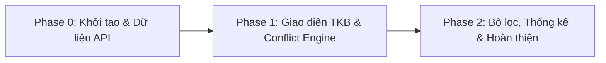

# Kế hoạch Triển khai Chi tiết (Implementation Plan)
## Dự án: SGU Timetable Studio
**Phiên bản**: 1.0.0  
**Tác giả**: Omni-IT Architect  
**Trạng thái**: Chờ duyệt (Awaiting Approval)  
**Tài liệu liên quan**: [01-analysis-spec.md](./01-analysis-spec.md)  

---

## 0. Tổng quan Dự án (Executive Summary)

| Thông tin | Giá trị |
|:---|:---|
| **Kiến trúc** | Client-Side SPA (Single Page Application) + Vite Dev Proxy |
| **Công nghệ lựa chọn** | React 19 + TypeScript + Vite + Tailwind CSS v4 + Zustand + Lucide Icons |
| **Tổng số chức năng nguyên tử** | 28 functions (vét sạch 100% từ `01-analysis-spec.md`) |
| **Số giai đoạn (Phases)** | 3 Phases (P0 ➔ P1 ➔ P2) |
| **Tổng thời gian dự kiến** | 16 - 20 giờ làm việc |

---

## 1. Lộ trình Triển khai Tổng quan (Milestone Overview)

| Giai đoạn | Tên Phase | Thời lượng | Mục tiêu cốt lõi | Sản phẩm bàn giao chính |
|:---|:---|:---|:---|:---|
| **Phase 0** | Khởi tạo & Dữ liệu API | 4 giờ | Bộ khung Vite, TS, Tailwind, Service kết nối SGU | Skeleton chạy được, nạp & parse dữ liệu môn học thành công |
| **Phase 1** | Giao diện Lưới TKB & Conflict Engine | 8 giờ | Lưới tuần 7 ngày, card môn, thuật toán check trùng | Xếp TKB trực quan, tự phát hiện trùng lịch thời gian thực |
| **Phase 2** | Bộ lọc, Thống kê & Xuất dữ liệu | 4 giờ | Tìm kiếm nâng cao, xuất ảnh PNG, copy mã tổ, lưu offline | Ứng dụng hoàn chỉnh 100%, sẵn sàng bàn giao |

---

## 2. Kế hoạch Chi tiết Từng Giai đoạn

### 🚀 Giai đoạn P0: Khởi tạo Nền tảng & Tầng Xử lý Dữ liệu SGU (4h)
> **Mục tiêu**: Dựng project chuẩn mực, thiết lập kiểu dữ liệu TypeScript, bộ phân tích chuỗi TKB và service kết nối API SGU.  
> **Phạm vi chức năng**: 1.1.1, 1.1.2, 1.1.3, 1.1.4, 1.2.1, 1.2.2, 1.2.3, 1.2.4

#### 📋 Danh sách công việc chi tiết (Tasks Checklist):

- [x] **[P0-01] Khởi tạo dự án Vite React TypeScript & Cấu hình Tailwind CSS** `(1h)`
  - **Module / File**: `package.json`, `vite.config.ts`, `tailwind.config.js`, `tsconfig.json`
  - **Phụ thuộc**: Không
  - **Chi tiết**: Thiết lập project React 19 + TypeScript, cấu hình Tailwind CSS v4 với bảng màu hiện đại (Slate, Indigo, Emerald, Rose), cài đặt Lucide Icons và cấu hình Vite Proxy trỏ về SGU server.
  - **Tiêu chuẩn nghiệm thu (DoD)**: Lệnh `npm run dev` khởi động thành công dưới 300ms, không có lỗi cấu hình.

- [x] **[P0-02] Định nghĩa Kiểu dữ liệu & Mô hình trạng thái (TypeScript Models)** `(1h)`
  - **Module / File**: `src/types/course.ts`, `src/types/schedule.ts`
  - **Phụ thuộc**: P0-01
  - **Chi tiết**: Khai báo đầy đủ các interface: `Course`, `ClassGroup`, `ScheduleItem`, `TimetableState`, `FilterOptions`.
  - **Tiêu chuẩn nghiệm thu (DoD)**: TypeScript type-check vượt qua 100% không `any`, đầy đủ kiểu dữ liệu cho response API SGU.

- [x] **[P0-03] Xây dựng Parser phân tách chuỗi Thời khóa biểu SGU** `(1h)`
  - **Module / File**: `src/utils/tkbParser.ts`, `src/utils/tkbParser.test.ts`
  - **Phụ thuộc**: P0-02
  - **Chi tiết**: Tách chính xác chuỗi TKB phức tạp của SGU (`Thứ X, tiết A->B, Ph Y, GV Z, ngày...
...`) thành mảng các phiên học có thứ, tiết bắt đầu/kết thúc, phòng học, tên giảng viên và khoảng ngày học.
  - **Tiêu chuẩn nghiệm thu (DoD)**: Vượt qua bộ test case với cả các trường hợp có 1 buổi, nhiều buổi, có thực hành, hoặc chưa xếp phòng.

- [x] **[P0-04] Xây dựng SGU API Client & State Store (Zustand)** `(1h)`
  - **Module / File**: `src/services/sguApi.ts`, `src/store/useTimetableStore.ts`
  - **Phụ thuộc**: P0-02, P0-03
  - **Chi tiết**: Kết nối endpoint `api/dkmh/w-locdsnhomto`, map danh mục tên môn học từ `ds_mon_hoc` vào mã môn, hỗ trợ nạp dữ liệu trực tiếp qua token hoặc qua dán JSON dự phòng.
  - **Tiêu chuẩn nghiệm thu (DoD)**: Tải và nạp được dữ liệu từ API hoặc file mẫu, state Zustand lưu trữ đầy đủ danh sách môn học đã chuẩn hóa.

---

### 📦 Giai đoạn P1: Lưới Thời khóa biểu Trực quan & Động cơ Xung đột (8h)
> **Mục tiêu**: Xây dựng lưới TKB 7 ngày x 12 tiết, thẻ hiển thị môn học với đầy đủ Giảng viên & Slot, thuật toán phát hiện trùng lịch tức thì.  
> **Phạm vi chức năng**: 2.1.1, 2.1.2, 2.1.3, 3.1.1, 3.1.2, 3.1.3, 3.1.4, 3.2.1, 3.2.2, 3.2.3, 3.3.1, 3.3.2

#### 📋 Danh sách công việc chi tiết (Tasks Checklist):

- [x] **[P1-01] Xây dựng Động cơ Kiểm tra Trùng lịch (Conflict Engine)** `(1.5h)`
  - **Module / File**: `src/utils/conflictDetector.ts`
  - **Phụ thuộc**: P0-02, P0-03
  - **Chi tiết**: Thuật toán so khớp các khoảng tiết học trong cùng thứ. Khi có ít nhất 1 tiết trùng nhau giữa 2 lớp học phần, đánh dấu xung đột, xác định chính xác cặp môn bị trùng và danh sách tiết bị trùng.
  - **Tiêu chuẩn nghiệm thu (DoD)**: Phát hiện chính xác 100% các ca trùng tiết chéo (VD: tiết 3-5 trùng với tiết 4-6).

- [x] **[P1-02] Thiết kế & Xây dựng Lưới Thời khóa biểu tuần (Visual Timetable Grid)** `(2.5h)`
  - **Module / File**: `src/components/TimetableGrid.tsx`, `src/components/ScheduleBlock.tsx`
  - **Phụ thuộc**: P1-01
  - **Chi tiết**: Lưới 7 cột (Thứ 2 đến Chủ Nhật) x 12 hàng tiết học với các mốc giờ chuẩn SGU. Khối môn học được định vị tuyệt đối theo tiết, màu sắc phân biệt tự động theo mã môn, hiệu ứng nhấp nháy viền đỏ cảnh báo khi trùng lịch.
  - **Tiêu chuẩn nghiệm thu (DoD)**: Khối môn hiển thị đúng vị trí thứ/tiết, click vào khối để xem chi tiết hoặc xóa nhanh khỏi TKB.

- [x] **[P1-03] Xây dựng Thẻ Lớp học phần (Course Card) & Danh sách duyệt** `(2.5h)`
  - **Module / File**: `src/components/CourseCard.tsx`, `src/components/CourseList.tsx`
  - **Phụ thuộc**: P0-04
  - **Chi tiết**: Hiển thị thẻ môn học với: Mã môn, Tên môn tiếng Việt, Tổ học, Số tín chỉ, Tên Giảng viên, Phòng học, và Badge Slot còn lại (xanh lá >20, vàng 5-20, đỏ <=5). Nút chọn/bỏ chọn phản hồi tức thì.
  - **Tiêu chuẩn nghiệm thu (DoD)**: Thẻ môn render mượt mà, đổi trạng thái active/conflict rõ ràng khi được chọn vào TKB.

- [x] **[P1-04] Thanh Tiêu đề & Bảng Thống kê TKB (Header & Quick Stats)** `(1.5h)`
  - **Module / File**: `src/components/Header.tsx`, `src/components/StatsBar.tsx`
  - **Phụ thuộc**: P1-02, P1-03
  - **Chi tiết**: Thanh header hiển thị tổng số môn đã chọn, tổng số tín chỉ tích lũy, số cặp môn bị xung đột lịch, nút Reset và nút Đăng nhập / Nạp dữ liệu.
  - **Tiêu chuẩn nghiệm thu (DoD)**: Các chỉ số cập nhật tự động (reactive) mỗi khi người dùng bấm chọn hoặc hủy môn.

---

### 🎯 Giai đoạn P2: Bộ lọc Nâng cao, Xuất dữ liệu & Đóng gói (4h)
> **Mục tiêu**: Bộ lọc đa tiêu chí, tính năng copy mã tổ, xuất ảnh TKB, lưu trữ offline và hoàn thiện giao diện 100%.  
> **Phạm vi chức năng**: 2.1.4, 2.1.5, 2.1.6, 2.1.7, 4.1.1, 4.1.2, 4.1.3, 4.1.4

#### 📋 Danh sách công việc chi tiết (Tasks Checklist):

- [x] **[P2-01] Xây dựng Bộ lọc & Tìm kiếm Tức thì (Search & Filter Bar)** `(1.5h)`
  - **Module / File**: `src/components/SearchFilter.tsx`
  - **Phụ thuộc**: P1-03
  - **Chi tiết**: Tìm kiếm gõ tới đâu lọc tới đó theo Tên môn (bỏ dấu tiếng Việt), Mã môn, Tên Giảng viên, Phòng học. Các nút tag lọc nhanh: Còn slot (>0), Đã chọn, Thứ trong tuần, Buổi sáng/chiều/tối.
  - **Tiêu chuẩn nghiệm thu (DoD)**: Tốc độ lọc phản hồi dưới 50ms cho danh sách > 500 lớp học phần.

- [x] **[P2-02] Tính năng Xuất dữ liệu (Copy Mã Tổ & Xuất ảnh PNG)** `(1.5h)`
  - **Module / File**: `src/utils/exportHelpers.ts`, `src/components/ExportModal.tsx`
  - **Phụ thuộc**: P1-02
  - **Chi tiết**: Nút 1-click sao chép toàn bộ danh sách mã môn & mã tổ vào Clipboard dạng text chuẩn; tích hợp xuất ảnh lưới Thời khóa biểu ra file PNG sắc nét để lưu vào điện thoại.
  - **Tiêu chuẩn nghiệm thu (DoD)**: Copy đúng định dạng mã nộp ĐKMH; xuất ảnh PNG rõ ràng không bị vỡ hạt.

- [x] **[P2-03] Kiểm thử Tổng thể, Tinh chỉnh Thẩm mỹ & Đóng gói Bản chạy** `(1h)`
  - **Module / File**: `src/index.css`, `README.md`
  - **Phụ thuộc**: P2-01, P2-02
  - **Chi tiết**: Rà soát độ tương phản, responsive trên tablet/laptop, kiểm thử toàn bộ 28 chức năng nguyên tử, viết hướng dẫn sử dụng và chạy thử nghiệm.
  - **Tiêu chuẩn nghiệm thu (DoD)**: 100% chức năng hoạt động trơn tru, không có lỗi console, build production thành công.

---

## 3. Ma trận Đối soát Chức năng (Traceability Matrix)

| Mã Chức năng (Atomic ID) | Tên Chức năng Nguyên tử | Phụ trách bởi Task | Giai đoạn (Phase) |
|:---|:---|:---|:---|
| **1.1.1** | Lưu trữ Bearer Token & Session | P0-04 | Phase 0 |
| **1.1.2** | Kiểm tra trạng thái hoạt động Token | P0-04 | Phase 0 |
| **1.1.3** | Đăng xuất & Xóa dữ liệu phiên | P0-04 | Phase 0 |
| **1.1.4** | Chế độ Offline / Nạp JSON dự phòng | P0-04 | Phase 0 |
| **1.2.1** | Gọi API w-locdsnhomto | P0-04 | Phase 0 |
| **1.2.2** | Đồng bộ tên môn từ ds_mon_hoc | P0-04 | Phase 0 |
| **1.2.3** | Parser chuỗi TKB SGU | P0-03 | Phase 0 |
| **1.2.4** | Lưu cache dữ liệu LocalStorage | P0-04 | Phase 0 |
| **2.1.1** | Tìm kiếm theo Tên môn học | P2-01 | Phase 2 |
| **2.1.2** | Tìm kiếm theo Mã môn học | P2-01 | Phase 2 |
| **2.1.3** | Tìm kiếm theo Tên Giảng viên | P2-01 | Phase 2 |
| **2.1.4** | Lọc theo trạng thái Slot | P2-01 | Phase 2 |
| **2.1.5** | Lọc theo Thứ trong tuần | P2-01 | Phase 2 |
| **2.1.6** | Lọc theo Buổi học (Sáng/Chiều/Tối) | P2-01 | Phase 2 |
| **2.1.7** | Sắp xếp danh sách (Slot, Tên, Tín chỉ) | P2-01 | Phase 2 |
| **3.1.1** | Thêm lớp học phần vào TKB | P1-03 | Phase 1 |
| **3.1.2** | Xóa lớp học phần khỏi TKB | P1-03 | Phase 1 |
| **3.1.3** | Đổi nhóm/tổ của cùng môn học | P1-03 | Phase 1 |
| **3.1.4** | Đặt lại (reset) toàn bộ TKB | P1-04 | Phase 1 |
| **3.2.1** | Vẽ lưới tuần 7 ngày x 12 tiết | P1-02 | Phase 1 |
| **3.2.2** | Hiển thị khối môn với dải màu nhận diện | P1-02 | Phase 1 |
| **3.2.3** | Xem popup chi tiết khối TKB | P1-02 | Phase 1 |
| **3.3.1** | Thuật toán phát hiện trùng tiết học | P1-01 | Phase 1 |
| **3.3.2** | Cảnh báo visual viền đỏ nhấp nháy | P1-02 | Phase 1 |
| **4.1.1** | Thống kê số môn, số tín chỉ | P1-04 | Phase 1 |
| **4.1.2** | Copy danh sách mã tổ vào Clipboard | P2-02 | Phase 2 |
| **4.1.3** | Xuất Thời khóa biểu thành ảnh PNG | P2-02 | Phase 2 |
| **4.1.4** | Xuất/Nhập cấu hình TKB qua JSON | P2-02 | Phase 2 |

**Số chức năng chưa phân bổ**: **0** (100% chức năng đều có task phụ trách).

---

## 4. Quản lý Rủi ro (Risk Register)

| Mã | Rủi ro Tiềm ẩn | Mức độ | Kế hoạch Giảm thiểu & Dự phòng |
|:---|:---|:---|:---|
| **R-01** | Trình duyệt chặn CORS khi gọi trực tiếp API SGU từ localhost | Cao | Cấu hình Vite Dev Proxy chuyển tiếp request; kèm theo cơ chế nạp JSON dự phòng nếu không dùng proxy. |
| **R-02** | Chuỗi TKB trả về từ trường có định dạng dị biệt (thiếu thứ, tiết đặc biệt) | Trung bình | Bộ parser có Regex linh hoạt, xử lý fallback gán vào mục "Chưa xếp lịch" thay vì gây crash ứng dụng. |
| **R-03** | Trường đột ngột đóng cổng API hoặc hết hạn Token | Thấp | Lưu cache cục bộ bản môn học gần nhất trong LocalStorage để người dùng vẫn tiếp tục xếp TKB offline được. |

---

## 5. Tiêu chuẩn Nghiệm thu Hoàn thành (Exit Criteria)

- [ ] Toàn bộ 28 chức năng nguyên tử được triển khai đầy đủ và kiểm thử thực tế.
- [ ] Giao diện đạt chuẩn **Impeccable Design**: Tinh tế, font chữ sắc nét, độ phản hồi mượt mà 60fps.
- [ ] Thuật toán phát hiện trùng lịch chính xác 100%.
- [ ] Hỗ trợ cả 2 chế độ: Kết nối live với API SGU hoặc Dán JSON ngoại tuyến.

